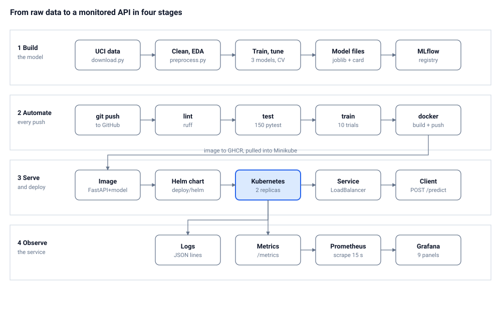

# Architecture

## Components

| Layer | Role | Technology |
| --- | --- | --- |
| Data | Download, validate and clean the Cleveland data | `ucimlrepo`, pandas |
| Modelling | One pipeline of cleaning, scaling, encoding and a classifier; tuning + cross-validation | scikit-learn, XGBoost, Optuna |
| Tracking | Record every run and register the best model | MLflow with SQLite |
| Packaging | Save the pipeline, a model card and pinned requirements | joblib, `requirements.lock` |
| Automation | Lint, test, train, build and smoke-test the container, publish the image | ruff, pytest, GitHub Actions, GHCR |
| Serving | HTTP API with input validation | FastAPI, pydantic, uvicorn |
| Deployment | Two replicas with probes behind a LoadBalancer | Docker, Helm, Kubernetes (Minikube) |
| Observability | JSON request logs, metrics, scraping and dashboards | prometheus-client, kube-prometheus-stack, Grafana |

## Design principles

- The same `Pipeline` object trains and serves — no train/serve drift.
- The same `make lint` and `make test` run on a developer machine and in CI.
- Settings live in files (`configs/cleveland.yaml`, `values.yaml`, `requirements.lock`), not in people's heads.
- Logs and metrics were added together with the API, not afterwards.
- CI pushes `ghcr.io/soham1601/mlops-project:{sha,latest}` on every `master` push.
- `scripts/deploy_prayogshala.sh` pulls that image into Minikube — the whole CI → GHCR → cluster loop runs with no manual image handling.

## Mapping the diagram to the repo

| Diagram node | File / directory |
| --- | --- |
| UCI data | `src/mlops_project/data/download.py` |
| Clean, EDA | `src/mlops_project/data/preprocess.py`, `src/mlops_project/data/eda.py` |
| Train, tune | `src/mlops_project/train.py`, `src/mlops_project/models.py` |
| Model files | `models/model.joblib`, `models/model_card.json` |
| MLflow | `src/mlops_project/tracking.py`, `configs/cleveland.yaml` → `tracking:` |
| CI jobs | `.github/workflows/ci.yml` |
| Image | `Dockerfile` |
| Helm chart | `deploy/helm/heart-api/` |
| FastAPI | `src/mlops_project/api/` |
| ServiceMonitor + Grafana dashboard | `deploy/helm/heart-api/templates/servicemonitor.yaml` and `.../grafana-dashboard.yaml` |
| Scripts | `scripts/setup_prayogshala.sh`, `scripts/deploy_prayogshala.sh`, `scripts/run_all.sh`, `scripts/smoke_test.sh`, `scripts/stop_prayogshala.sh` |
